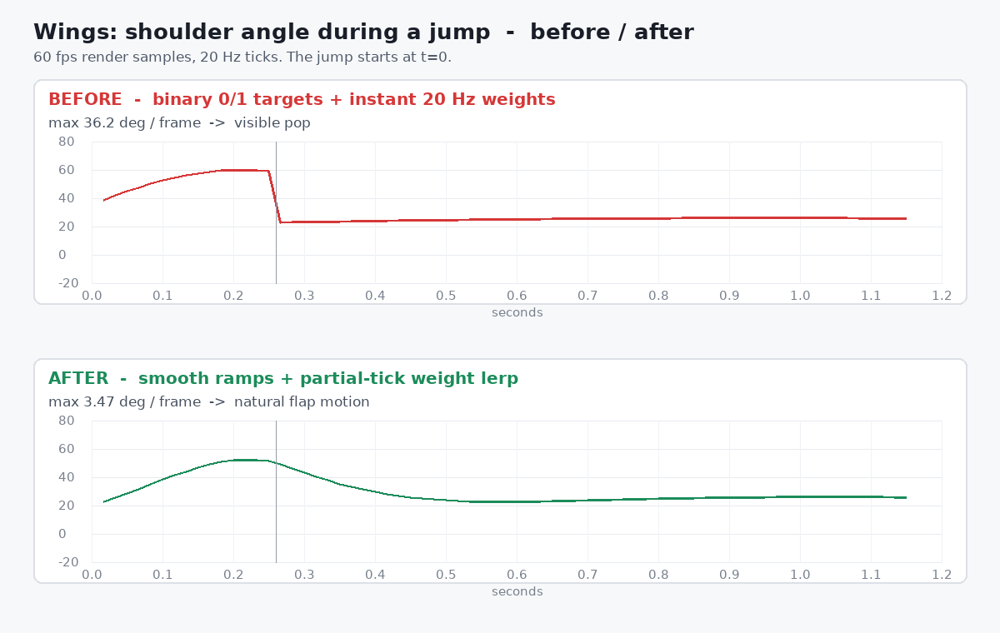
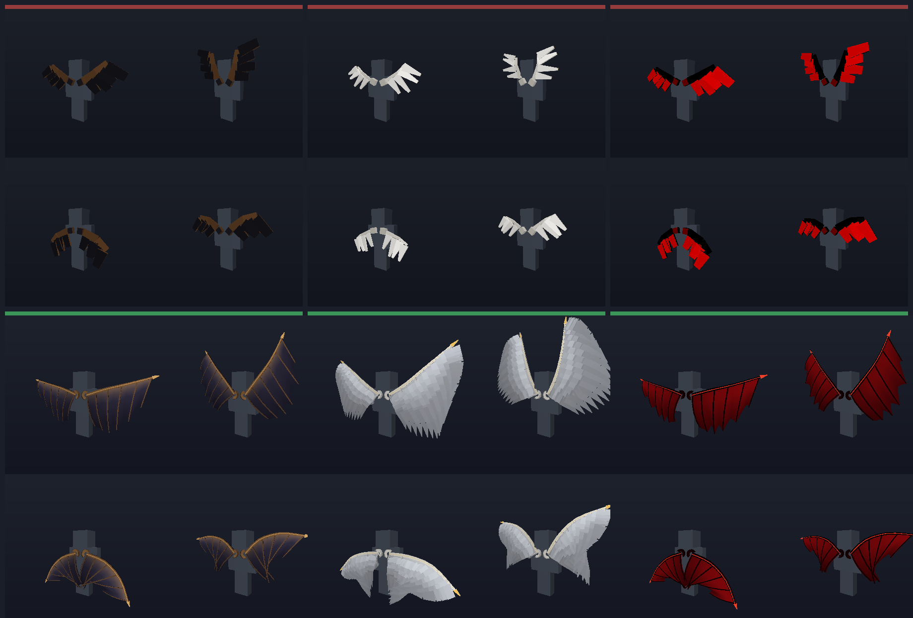

# BedrockToolsPlus

## Upstream synchronization

Compatibility signatures, SDK offsets, and interaction-hook ABI are updated from [QYCottage/BedrockTools](https://github.com/QYCottage/BedrockTools) at `3de9a7d641c8222a9bf536d828449a27b58cd20a` (v1.5.8, Minecraft Bedrock `1.26.60.X`). The shader-color and selection-material offsets also incorporate the upstream 1.26.60 rendering fix from `c5bf5347fc8d`. Upstream modules and their overlay bridge are not included; Plus modules can be extended independently. Plus branding, resources, configuration migration, and build optimizations are retained. The upstream MIT notice is preserved in `LICENSE.upstream`; the Plus license remains in `LICENSE`.

Android builds are provided by the build workflow; host tests do not validate offsets or hooks against a running game.

## Introduction

BedrockToolsPlus is an open-source native mod for Minecraft Bedrock on Android, made for [LeviLauncher](https://github.com/LiteLDev/LeviLaunchroid). It adds a collection of visual, HUD, player, and utility modules while also providing a small C++ SDK and event system for native mod development.

The source is public so people can study how a real LeviLauncher mod is structured, learn from it, and use the SDK as a starting point for their own mods.

## Features

- Native C++20 mod built for LeviLauncher and Preloader
- 13 configurable modules
- Public headers for Minecraft wrappers, offsets, signatures, and utilities
- Typed event system with runtime subscriptions for other native mods
- LeviLauncher mod-menu integration and persistent configuration
- Open-source and designed to be practical to extend

## Modules

**Visual:** Hitbox, Block Outline, Wings, Jump Circle, Damage Circle

**HUD:** Effect Display, Crosshair, Inventory HUD, Armor

**Player:** Custom Capes

**Misc:** Hit Sound, CommentKey, Command Hotkey

## Hitbox

**Hitbox** draws the collision boxes of nearby entities and players, plus optional eye and look lines, as a world-space overlay.

- Boxes are drawn at the interpolated render position the game draws each entity at, not at the raw collision AABB. The raw box snaps a whole tick of movement ahead of the smoothly moving body, which reads as the hitbox lagging behind the player; **Smooth Boxes** (on by default) derives the interpolation phase from each entity's own box samples, so a stalled tick callback (for example while gliding with a firework-boosted elytra) can never leave a box frozen behind the player. Turning it off gives the plain tick boxes back.
- **Show Entities**, **Show Players** and **Show Items** pick which groups are drawn, **Hitbox Color** and **Show Items Color** style them, and **Line Thickness** above 1 draws real camera-facing geometry because most mobile GLES drivers ignore native line width. Box and line colors remain independent of the game's shader tint in both camera perspectives.
- There is no Range setting any more: the module scans a fixed ~128-block radius around you (far beyond the ~50-block sight the overlay is used at) and draws everything the game fetches there. **Show Entities**, **Show Players** and **Show Items** decide which groups are drawn — turn **Show Items** off if a mob/item farm floods the screen.
- **Show 3rd Person** adds your own box while the camera is behind you, **Show Eye Line** and **Show Look Line** annotate every box, and **Hitbox Indicator** recolors the box under your crosshair with **Indicator Active Color** / **Indicator Default Color**. The highlight follows the game's own crosshair verdict, so an entity lights up only when the game itself says it is within your allowed attack distance (3 blocks in survival, 5 in creative); when that verdict is unavailable the indicator falls back to a 3-block reach measured from your own box.
- Boxes hidden behind solid blocks are culled, so a wall stops an entity's box from showing through it.

## Block Outline

**Block Outline** draws a configurable world-space overlay over the hard-to-see selected-block border. It only follows the block currently under the crosshair and is entirely client-side.

- **Outline**, **Outline Color**, **Outline Opacity** and **Line Thickness** control the 12 block edges. Thickness uses real camera-facing geometry above the hairline setting, so it works on Android GLES drivers that ignore native line width, and the corners stay closed and square at every thickness.
- **Fill** adds a translucent block overlay. **Fill Face Only** limits it to the face under the crosshair; otherwise all six faces are drawn. **Fill Color** and **Fill Opacity** are independent from the outline.
- **Rainbow** animates both passes, with **Rainbow Speed** controlling the cycle. **Pulse** smoothly animates their opacity, with a separate **Pulse Speed**.
- Translucent passes actually blend: any pass with **Opacity** below 1 (or an active **Pulse**) renders with an alpha-blended, still depth-tested material, because the vanilla selection material has no blending state and would ignore the alpha. Fully opaque settings keep the vanilla look.
- **Through Walls** switches to a no-depth material when the current game build provides it. It is off by default, so terrain normally occludes the overlay.
- Outline and fill colors are isolated from the game's shader tint in first and third person; the previous game render state is restored after the overlay.

The target is sampled on the client tick instead of resolving the hit result from the render thread, avoiding frame stalls. Settings and keybind state are persisted in `config.json`.

## Jump Circle

Enable **Jump Circle** to show a soft effect at takeoff and landing, including when walking off a block. **Effect Style** offers 13 shapes: Circle, Square, Star, Triangle, Diamond, Pentagon, Hexagon, Octagon, Four Point Star, Six Point Star, Heart, Flower and Gear; **Effect Duration** controls expansion and fade time (0.1–10 seconds); **Effect Color** sets the color and opacity, while **Rainbow** cycles through RGB colors at **Rainbow Speed** (using the selected opacity instead of the selected RGB color).

**Damage Circle** draws a ring slightly larger than Jump Circle's fully expanded ring by default. Choose from the same 13 **Effect Style** shapes, change **Effect Color** and opacity, or enable **Rainbow** and adjust **Rainbow Speed**. The ring follows the entity—even while moving—and travels from the feet to the top of the hitbox, then back down. **Effect Duration** (0.1–10 seconds) controls only how long the ring remains visible and fades. **Effect Speed** (0.25–4) independently controls how quickly it travels up and down, while **Effect Size** (0.5–2.5) adjusts its fixed diameter. **Show Players** and **Show Mobs** independently enable effects on players and mobs you successfully hit; your own damage effect remains enabled. Effects are local-only.

In **Jump Circle**, enable **Persistent** to keep effects visible after they expand instead of fading. For mobile performance, only the most recent 24 effects are retained; disabling the module or changing worlds clears them. Turning Persistent off allows older effects to expire. The effect is depth-tested and visible in third person.

Jump and landing are inferred from vertical movement, not a verified game-side ground event. Automatic jumps and walking off blocks do not depend on button input, but unusual movement, flight, water, bounce effects, jump boosts or partial-block steps may be missed or mistaken for jumps/landings. Rendering depends on the supported Bedrock version's native signatures and materials.

## Inventory HUD

Shows the 27 slots of your inventory grid on the HUD without opening the inventory. Under **Details** you can toggle **Stack Count** and **Durability Bar**, **Number Text** changes the size and color of the stack counts, and **Slot Background** (on by default) draws a cell behind every slot — empty ones included — so the grid reads like the inventory screen. **Background Color** and **Background Opacity** style those cells.

The module owns a single HUD Editor element, **Inventory Grid**. Armor and the offhand are no longer part of it — they live in the separate **Armor** module below.

## Armor

**Armor** is its own module: it draws your helmet, chestplate, leggings, boots and the offhand item on the HUD, with or without Inventory HUD enabled. It has its own toggle, keybind, settings and HUD Editor element (**Armor & Offhand**), so it can be placed anywhere on screen independently of the inventory grid.

- **Offhand Slot**, **Right Hand**, **Stack Count** and **Durability Bar** under **Details** control what is drawn. Like the vanilla inventory, counts are shown only for visible stacks larger than one, and bars only for damaged, damageable items. Enable **Right Hand** to see the count of the stack you are carrying. Count text shrinks when needed to fit small slots.
- **Armor Durability Numbers** is on by default and displays each piece's remaining/maximum durability (for example, `220/363`), including fully repaired armor. It works independently of the durability bars, and its labels are part of the armor element.
- **Slot Background** (on by default) draws a cell behind every armor and offhand slot — empty ones included — so the column reads like the inventory screen. **Background Color** and **Background Opacity** style those cells.
- **Horizontal Layout** lays the five slots out in a row instead of a column.

Configs saved while armor was still an Inventory HUD option are migrated automatically: the new module inherits the position, size and style you had, and it starts enabled only if **Armor & Offhand** was on.

## Crosshair

**Crosshair** replaces the game's own crosshair with one of 29 shapes drawn at the exact screen center. The **Style** picker is grouped by how the shape reads on screen:

- **Marks** — Dot, Plus, X, T Shape, T Shape Down, Chevron, Arrow, Star
- **Gapped crosses** — Cross, Cross Dot, Cross X, Vertical, Horizontal
- **Rings** — Circle, Circle Dot, Circle Cross, Ring Ticks, Broken Ring, Target
- **Boxes** — Square, Square Dot, Diamond, Triangle, Brackets, Brackets Dot, Grid
- **Reticles** — Scope, Mil Dots, Converge

Every shape shares the same controls: **Scale** and **Thickness** set the size and the line weight, **Color** plus **Opacity** style it, and **Outline** adds a dark back-pass so bright skies and sand stay readable. **Rgb** animates the hue through the whole wheel with **Rgb Speed** controlling the cycle. **Indicator** recolors the crosshair (with **Indicator Color**) while you are aiming at a mob or another player — the hit test lives in this module, so it works without enabling Hitbox. **Show Third Person** also draws the overlay while the camera is behind or in front of you; it is off by default, like vanilla.

Selecting **Vanilla** gives the crosshair back to the game: the module then only tints the game's own crosshair when the indicator fires (and, on builds that cannot be tinted in place, briefly swaps it for a same-shaped overlay), so exactly one crosshair is ever on screen. New styles are always appended to the picker, so configs saved by an older version keep drawing the same shape.

## Wings

The **Wings** module renders animated 3D wings on your back that flap, idle and glide with your movement. Open the module's **Wing Style** selector to choose a shape:

- **Dragon** — the default: a broad bone-framed membrane wing
- **Angel** — layered white primaries with gold tips
- **Demon** — black bones with a glowing blood-red membrane
- **Bat** — a small, dark violet membrane wing
- **Butterfly** — rounded pink and blue lobes
- **Phoenix** — long fiery orange primaries
- **Fairy** — small translucent cyan/pink wings
- **Demon Wings** — larger black-framed crimson wing with a glow aura
- **Vampire Bat** — a narrower crimson membrane with deeper fingers
- **Red Bat** — the shortest, most saturated bat wing

**Motion:** the idle → flap → glide transitions are continuous ramps. Speeds measured from the player's tick-quantised AABB are low-pass filtered, the blend weights ease toward their targets with a real time constant, and the render thread lerps them between the last two ticks by the partial-tick fraction. A vanilla jump no longer flips the pose (idle → flap → glide → idle) in one 50 ms tick, which used to pop the wings by tens of degrees in a single frame. Short hops never enter the spread glide pose; gliding needs a sustained descent. The wing anchor is interpolated from the last two AABB samples the same way the game interpolates the player mesh, using the same sample history as Hitbox, so walking and jumping stay smooth at any frame rate. `tests/wings_patch_test.cpp` drives a 60 fps jump through `WingsModule::boneAnglesAt()` and asserts the shoulder angle never jumps more than 6°/frame (it was ~36°/frame before this fix).



*Shoulder angle over one jump: the old 0/1 pose switch produced a one-frame
pop; the continuous blend stays within the natural flap speed.*

The wings are a world-space overlay (a `RenderLevel` hook + tessellator); they never touch skin memory and only appear from a third-person point of view. They are drawn with a depth-tested game material, so your body correctly occludes them when the camera swings in front of you, and the side facing the camera is auto-selected: the bright membrane from behind, a darker shadowed underside from the front. Every style is one continuous membrane instead of a chain of boxes: an articulated arm (shoulder, elbow, wrist) is bent into a smooth leading edge, and a cambered sail hangs off it with a swept, scalloped trailing edge, finger struts, a spar and wing-tip claw, a shoulder fairing and — on the feathered styles — three overlapping rows of quills. The sheet ripples while you flap and goes taut while you glide, and it is shaded per face with a headlight plus a sky lift so it keeps its volume from every angle.



*Top row: the old per-bone box renderer. Bottom row: the membrane wing
(Dragon, Angel, Demon).*

Developers can preview every style offline with `./scripts/gen_wings_preview.sh`, which writes a pose sheet, a close-up and a showcase of all styles to `build/wings-preview/`. The geometry is pure C++ (`src/modules/visual/wings_design.hpp` + `wings_surface.hpp`), so the preview and `tests/wings_shape_test.cpp` rasterize/assert exactly what the game draws.

## Custom Capes

The **Custom Capes** module lets you wear any PNG as a classic cape. It is local-only: only you see it, nothing is sent to the server, and your account is untouched.

1. Put cape images (`.png`) into the `capes` folder next to your `config.json` (`<mod config dir>/capes`, created automatically on first launch along with a `Sample Cape.png`). The menu shows the exact **Capes Folder** path, and **Copy Folder Path** puts it on the clipboard so you can paste it into your file manager or browser download prompt.
2. (Re)launch the game, open the BedrockToolsPlus mod menu and enable **Custom Capes**. The picker lists every cape in the folder by name (the `.png` suffix is hidden).
3. Pick a cape in the **Cape** selector — it applies on the next tick, no rejoin needed. Choose `None` to get your vanilla cape back.
4. Added or replaced a file while the game was running? Press **Reload** to re-read the folder and the selected file. A *new* file also needs a menu reload, because the picker's option list is built when the menu is registered.

**Image fitting.** The cape's visible face is a 10×16 pixel portrait, so an arbitrary image has to be mapped onto it. **Fit** decides how:

- **Cover** (default) — fill the face and crop the overflow. Nothing is distorted; the outer edges of the image are lost.
- **Contain** — keep the whole image and pad the leftover with its edge colours. Nothing is lost; wide images get bars.
- **Stretch** — scale both axes independently. Fills the face but distorts faces and text.

Large images are *area-averaged* down to the cape face instead of point-sampled, so a 700×800 photo stays readable instead of turning into noise, and thin details (text, logo outlines) do not shimmer. Transparent areas are averaged premultiplied, so a logo on a transparent background keeps its colour instead of darkening towards black. A 10×16 source is also a perfectly valid cape and maps pixel-for-pixel.

**What the module writes.** The image goes onto the outer back face (`x=1..11, y=1..17`) of the 64×32 cape canvas. The inner front face gets one flat lining colour (the design's average at half brightness) instead of a repeat of the image, and the top/bottom/side edge strips continue the image's edge colours so the one-voxel-thick cape keeps its thickness. The design is also mapped onto the tapered Elytra wing UV (`22,0`), so a cape keeps looking like your design when you fly. An exact 64×32 image is used pixel-for-pixel, including any Elytra wings you drew yourself; wings are only generated when that area is empty.

**Validation.** Every file is checked against the PNG signature and its IHDR before it is decoded, and images above 2048×2048 (or with a corrupt header) are refused, so a renamed JPEG or a huge PNG cannot reach the decoder and exhaust memory. A file that fails simply stays unapplied — the vanilla cape remains, and **Reload** retries after you fix it. File names containing a comma are skipped, because the launcher's picker cannot represent them.

**Safety.** The cape pixels are injected into the live `SerializedSkinImpl::mCapeImage` (never into the skin texture, which is what made older builds fall back to Steve) with a freshly generated cape id, since modern builds only render a classic cape when one is set. `mAlphaUsage` is set to `Transparent` next to the image's own `mUsage`, so the renderer samples the RGBA blob with its alpha channel instead of treating it as opaque data. The injected blob is `malloc`'d and tagged with `free()`, so the engine can safely destroy or replace it, and the original cape pointer and id are restored bit-for-bit when you pick `None` or disable the module. Leaving the world detaches the module from the skin before the engine frees it, which is what keeps Leave World crash-free. Menu callbacks and the game tick share the module state behind a mutex.

**Only the local player is patched.** `Actor::normalTick` — the hook the tick event comes from — fires for every actor in the level, so the handler resolves the local player through `ClientInstance` and compares pointers before touching a skin. Without that check the module patched whichever actor ticked last (usually a mob or another player), which is why the cape appeared not to change at all. If the client instance is not available yet the tick is skipped rather than guessed.

**The status row tells you why it is not applied.** Because the tick path cannot log, the last decision is recorded and rendered in the menu as `<n> capes - <file> [<state>]`. The state is one of `applied`, `off`, `waiting for a world`, `cannot read the player skin`, `persona skin: classic capes are not rendered`, `skin layout mismatch (unsupported game build)`, `no cape loaded` or `the selected PNG could not be loaded`. If the cape still does not change, that row (or logcat) says which of those cases you are in.

**Persona skins have no classic cape.** A Character Creator (persona) skin does not use `mCapeImage`, so the module deliberately leaves those alone and reports `persona skin` in the status row; switch to a classic skin to use a custom cape.

Persona skins are not affected — capes are persona pieces there.

## Hit Sound

The **Hit Sound** module plays a custom sound of your choice every time you land a melee hit on a mob or another player.

1. Put sound files (`.wav`, `.ogg`, `.mp3`, `.m4a` or `.flac` — ideally short one-shot effects; a `Sample Hit.wav` is generated for you on first launch) into the `hitsounds` folder next to your `config.json` (`<mod config dir>/hitsounds`, created automatically on first launch).
2. (Re)launch the game, open the BedrockToolsPlus mod menu and enable **Hit Sound**.
3. Pick a file in the module's **Sound** selector — every audio file in the folder shows up there. Choose `None` to keep the vanilla behavior. The **Volume** slider sets how loud the sound plays.

The sound is a purely client-side overlay: the victim's own hurt sound is not cancelled or replaced, and nothing is sent to the server. Files whose names contain a comma are ignored (the menu picker cannot represent them), and sounds that fail to decode on your device are simply skipped.

## System Requirements

- Android 9 or newer
- 64-bit ARM device (`arm64-v8a`)
- [LeviLauncher](https://github.com/LiteLDev/LeviLaunchroid)
- Minecraft Bedrock **1.26.50** (`1.26.50.4`) — the version declared in `levimod.json`; other builds may work but are untested

## Installation

1. Install LeviLauncher.
2. Download the latest `BedrockToolsPlus.levipack` release.
3. Import the package from LeviLauncher's mod manager and enable it.
4. Launch Minecraft through LeviLauncher.

## Development Setup

Requirements:

- Android NDK r28c
- xmake
- Python 3

Build for Android ARM64:

```sh
xmake f -y -p android -a arm64-v8a -m release --ndk=/path/to/android-ndk-r28c
xmake -y
```

The release build produces `libBedrockToolsPlus.so` and `BedrockToolsPlus.levipack` in the xmake target directory.

Host-side unit tests (no game or NDK needed) run with:

```sh
./scripts/run_tests.sh
```

That covers the pure logic — cape resampling and fitting, the picker format, the skin-patch state machine, block-outline geometry, wing shapes, HUD layout and more. A few tests need the preloader/nlohmann_json headers from the xmake cache; point `PRE_LOADER_INCLUDE`, `JSON_INCLUDE` and `ENTT_INCLUDE` at them (or run `xmake f` once) and they stop being skipped. The Custom Capes tests are:

- `tests/customcapes_test.cpp` — folder scanning, picker labels/format, PNG header validation, fit modes and the sampler.
- `tests/customcapes_patch_test.cpp` — the in-game skin patch, fit changes, corrupt files and the Leave World teardown.
- `tests/customcapes_menu_test.cpp` — what the module registers in the launcher menu (picker, fit radio, buttons, status row), and that a config which toggles the module can be loaded without deadlocking.
- `tests/module_registration_smoke_test.cpp` — registers *every* module through the real launcher path and checks the definition the launcher receives, so a single malformed setting can never silently empty the menu.

The mod library is loaded by the preloader with `dlopen(RTLD_NOW)`, so a single undefined symbol makes the **whole** library fail to load — no module is registered and the launcher menu is completely empty. The build does not catch that, so `scripts/check_undefined_symbols.py` inspects the packaged `.so` (CI runs it after the release build) and fails on any symbol that is not defined in the library, provided by the preloader (`pl::*`) or provided by the platform (libc/libm/libdl/EGL/GLES/log). Practical consequence: a `#if !defined(__ANDROID__)` guard must never remove an implementation another translation unit still calls — that is what dropped the PNG writer from the device build while Wings kept calling `stbi_write_png()`.

The launcher registers the menu independently of the game hooks: if a signature cannot be resolved for the running Minecraft build, the modules are still registered and the hooks are retried, so the mod menu never ends up empty after a game update. Registration is also fault tolerant per module — a module whose `onInit()`/`saveConfig()` throws, or whose definition the launcher refuses, is logged (tag `BedrockToolsPlus`) and skipped while the rest of the menu stays available.

Public SDK headers are under `include/bedrocktools`. Shared runtime code lives under `src/core`, while features are kept under `src/modules` by category. Minecraft signatures and offsets are version-specific, so those are the main pieces that normally need updating for a new game build.

Example event subscription from another native mod:

```cpp
#include <bedrocktools/BedrockToolsPlus.hpp>

bedrocktools::events::RuntimeListener<bedrocktools::events::LocalPlayerTickEvent> listener(
    [](auto& event) {
        if (!event.player) return;
        auto position = event.player->position();
    }
);
```

## Contributing

Pull requests are highly appreciated. Keep changes focused, preserve the existing project structure, and test changes against the intended Minecraft version before submitting them.

## Usage Guidelines

Do not use LeviLauncher or BedrockToolsPlus to violate Mojang or Microsoft's user agreements.

**Disclaimer:** The authors and contributors of BedrockToolsPlus and LeviLauncher are not responsible for bans, damages, or issues arising from the use of this software. Use it at your own risk and in accordance with Minecraft's terms of service.

## Credits & Acknowledgements

BedrockToolsPlus is made by [RadiantByte](https://github.com/RadiantByte) and maintained by VENOM P2 GM.

Special thanks to [dreamguxiang](https://github.com/dreamguxiang) for helping make this mod possible.

Motion blur module based on [mcpelauncher-motion-blur](https://github.com/CrackedMatter/mcpelauncher-motion-blur) by [CrackedMatter](https://github.com/CrackedMatter).

Thanks to [Kashifro](https://github.com/Kashifro) for the Shulker Preview and Tablist modules.

Built for [LeviLauncher](https://github.com/LiteLDev/LeviLaunchroid).

## Contact

Discord: [discord.gg/rMgdpTFFVg](https://discord.gg/rMgdpTFFVg)

**Report Issues:** Open an issue in this GitHub repository.

## License

BedrockToolsPlus is licensed under the [GNU General Public License v3.0](LICENSE).
