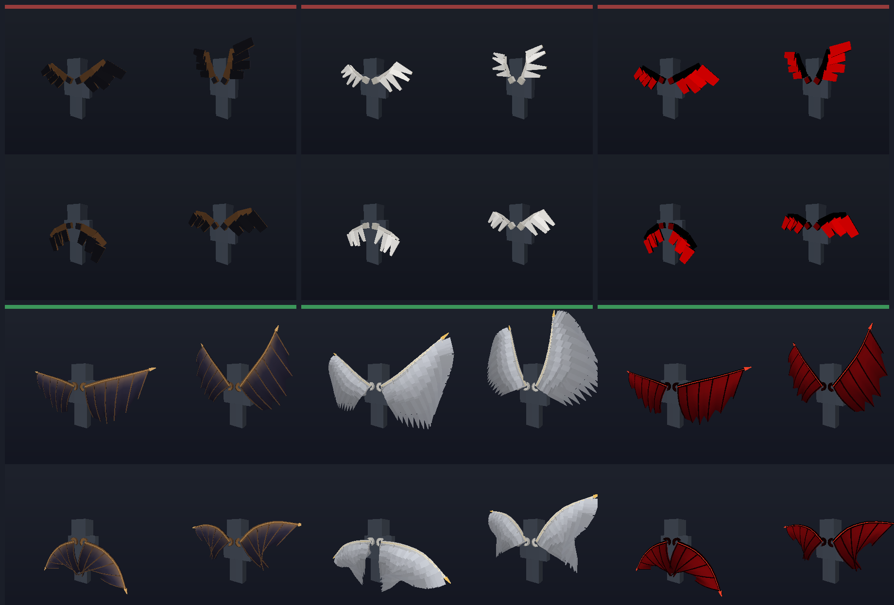

# BedrockToolsPlus

## Upstream synchronization

Compatibility signatures, SDK offsets, and interaction-hook ABI are updated from [QYCottage/BedrockTools](https://github.com/QYCottage/BedrockTools) at `3de9a7d641c8222a9bf536d828449a27b58cd20a` (v1.5.8, Minecraft Bedrock `1.26.60.X`). The pre-update Plus module list is unchanged: upstream modules and their overlay bridge are not included. Plus branding, resources, configuration migration, and build optimizations are retained. The upstream MIT notice is preserved in `LICENSE.upstream`; the Plus license remains in `LICENSE`.

Android builds are provided by the build workflow; host tests do not validate offsets or hooks against a running game.

## Introduction

BedrockToolsPlus is an open-source native mod for Minecraft Bedrock on Android, made for [LeviLauncher](https://github.com/LiteLDev/LeviLaunchroid). It adds a collection of visual, HUD, player, and utility modules while also providing a small C++ SDK and event system for native mod development.

The source is public so people can study how a real LeviLauncher mod is structured, learn from it, and use the SDK as a starting point for their own mods.

## Features

- Native C++20 mod built for LeviLauncher and Preloader
- 14 configurable modules
- Public headers for Minecraft wrappers, offsets, signatures, and utilities
- Typed event system with runtime subscriptions for other native mods
- LeviLauncher mod-menu integration and persistent configuration
- Open-source and designed to be practical to extend

## Modules

**Visual:** Hitbox, ESP, Block Outline, Wings

**Combat:** Kill Aura

**HUD:** Effect Display, Crosshair, Hotbar Slots, Inventory HUD, Armor

**Player:** Custom Capes

**Misc:** Hit Sound, CommentKey, Command Hotkey

## Hitbox

**Hitbox** draws the collision boxes of nearby entities and players, plus optional eye and look lines, as a world-space overlay.

- Boxes are drawn at the interpolated render position the game draws each entity at, not at the raw collision AABB. The raw box snaps a whole tick of movement ahead of the smoothly moving body, which reads as the hitbox lagging behind the player; **Smooth Boxes** (on by default) derives the interpolation phase from each entity's own box samples, so a stalled tick callback (for example while gliding with a firework-boosted elytra) can never leave a box frozen behind the player. Turning it off gives the plain tick boxes back.
- **Show Entities**, **Show Players** and **Show Items** pick which groups are drawn, **Hitbox Color** and **Show Items Color** style them, and **Line Thickness** above 1 draws real camera-facing geometry because most mobile GLES drivers ignore native line width.
- There is no Range setting any more: the module scans a fixed ~128-block radius around you (far beyond the ~50-block sight the overlay is used at) and draws everything the game fetches there. **Show Entities**, **Show Players** and **Show Items** decide which groups are drawn — turn **Show Items** off if a mob/item farm floods the screen.
- **Show 3rd Person** adds your own box while the camera is behind you, **Show Eye Line** and **Show Look Line** annotate every box, and **Hitbox Indicator** recolors the box under your crosshair with **Indicator Active Color** / **Indicator Default Color**. The highlight follows the game's own crosshair verdict, so an entity lights up only when the game itself says it is within your allowed attack distance (3 blocks in survival, 5 in creative); when that verdict is unavailable the indicator falls back to a 3-block reach measured from your own box.
- Boxes hidden behind solid blocks are culled, so a wall stops an entity's box from showing through it.

## ESP

**ESP** is the through-walls counterpart of Hitbox: it draws nearby players, mobs and items as world-space boxes that stay visible through terrain, so nothing around you stays hidden.

- **Players**, **Mobs** and **Items** each have their own toggle and color. Items are off by default (farms get noisy fast).
- Three combinable passes share the group color: **Box** (the 12 edges of the collision box, with **Line Thickness** drawn as real geometry like Hitbox), **Fill** (a translucent shell with **Fill Opacity**) and **Tracers** (a line from the camera to the center of each box).
- **Through Walls** is on by default and uses a no-depth-test material when the game build provides one; turn it off and terrain occludes the overlay again. Unlike Hitbox there is no voxel culling — seeing everything is the point.
- **Show Invisible** (on by default) keeps actors with invisibility effects on the overlay. **Esp Range** sets the actor scan radius (8–128 blocks), and **Smooth Boxes** draws at the interpolated render position so boxes do not snap a tick ahead of moving entities.

## Kill Aura

**Kill Aura** automatically attacks the players and mobs around you. It calls the game's own melee attack path (the same `GameMode::attack` the vanilla attack input uses), so damage, cooldowns, knockback and the server transaction are all produced by the game itself — nothing is forged at the packet level, and modules like Hit Sound keep working.

- **Attack Range** (1–8 blocks, default 3 — the vanilla survival reach) is measured the way the game measures it: from your eyes to the *closest point* of the target's collision box, which is also the hit position of the attack. Servers still enforce their own reach limit, so values past ~3 are mostly useful in singleplayer/creative or on lenient servers.
- **Cps** sets the attack rate (1–30). Attacks run on the game tick, so anything above 20 simply attacks every tick. The timer only advances when an attack actually fires, so a target stepping into range is hit on the next tick.
- **Attack Players** / **Attack Mobs** pick the target groups, **Attack Invisible** also strikes actors you cannot see, and **Multi Attack** hits every valid target in range each interval instead of only the nearest one.
- **Rotate To Target** snaps your view onto the target before attacking (visible, client-side rotation — off by default, since the attack itself does not need it), and **Swing** plays the arm animation with each attack.
- **Only Visible Targets** skips actors that are fully behind solid blocks (the same voxel visibility check Hitbox uses). Kill Aura always pauses while a container or chat screen is open.

One implementation note for developers: there is no signature for the local player's `GameMode` object. The module derives its slot in `Player` from the verified `mSkin` offset (the layout keeps `mGameMode`, `mSpawnRandomizer`, `mSkin` as three consecutive pointers) and *validates* the object against the resolved attack functions (vtable slot 16) before every use. If a future game build moves the member, validation fails and the module falls back to the GameMode pointer captured from the game's own action events — any manual attack, block place or item use refreshes it — instead of calling through a wrong pointer.

## Block Outline

**Block Outline** draws a configurable world-space overlay over the hard-to-see selected-block border. It only follows the block currently under the crosshair and is entirely client-side.

- **Outline**, **Outline Color**, **Outline Opacity** and **Line Thickness** control the 12 block edges. Thickness uses real camera-facing geometry above the hairline setting, so it works on Android GLES drivers that ignore native line width, and the corners stay closed and square at every thickness.
- **Fill** adds a translucent block overlay. **Fill Face Only** limits it to the face under the crosshair; otherwise all six faces are drawn. **Fill Color** and **Fill Opacity** are independent from the outline.
- **Rainbow** animates both passes, with **Rainbow Speed** controlling the cycle. **Pulse** smoothly animates their opacity, with a separate **Pulse Speed**.
- Translucent passes actually blend: any pass with **Opacity** below 1 (or an active **Pulse**) renders with an alpha-blended, still depth-tested material, because the vanilla selection material has no blending state and would ignore the alpha. Fully opaque settings keep the vanilla look.
- **Through Walls** switches to a no-depth material when the current game build provides it. It is off by default, so terrain normally occludes the overlay.

The target is sampled on the client tick instead of resolving the hit result from the render thread, avoiding frame stalls. Settings and keybind state are persisted in `config.json`.

## Inventory HUD

Shows the 27 slots of your inventory grid on the HUD without opening the inventory. Under **Details** you can toggle **Stack Count** and **Durability Bar**, **Number Text** changes the size and color of the stack counts, and **Slot Background** (on by default) draws a cell behind every slot — empty ones included — so the grid reads like the inventory screen. **Background Color** and **Background Opacity** style those cells.

The module owns a single HUD Editor element, **Inventory Grid**. Armor and the offhand are no longer part of it — they live in the separate **Armor** module below.

## Armor

**Armor** is its own module: it draws your helmet, chestplate, leggings, boots and the offhand item on the HUD, with or without Inventory HUD enabled. It has its own toggle, keybind, settings and HUD Editor element (**Armor & Offhand**), so it can be placed anywhere on screen independently of the inventory grid.

- **Offhand Slot**, **Right Hand**, **Stack Count** and **Durability Bar** under **Details** control what is drawn. Like the vanilla inventory, counts are shown only for visible stacks larger than one, and bars only for damaged, damageable items. Enable **Right Hand** to see the count of the stack you are carrying. Count text shrinks when needed to fit small slots.
- **Armor Durability Numbers** is on by default and displays each piece's remaining/maximum durability (for example, `220/363`), including fully repaired armor. It works independently of the durability bars, and its labels are part of the armor element.
- **Slot Background** (on by default) draws a cell behind every armor and offhand slot — empty ones included — so the column reads like the inventory screen. **Background Color** and **Background Opacity** style those cells.
- **Horizontal Layout** lays the five slots out in a row instead of a column.

Configs saved while armor was still an Inventory HUD option are migrated automatically: the new module inherits the position, size and style you had, and it starts enabled only if **Armor & Offhand** was on.

## Crosshair

**Crosshair** replaces the game's own crosshair with one of 29 shapes drawn at the exact screen center. The **Style** picker is grouped by how the shape reads on screen:

- **Marks** — Dot, Plus, X, T Shape, T Shape Down, Chevron, Arrow, Star
- **Gapped crosses** — Cross, Cross Dot, Cross X, Vertical, Horizontal
- **Rings** — Circle, Circle Dot, Circle Cross, Ring Ticks, Broken Ring, Target
- **Boxes** — Square, Square Dot, Diamond, Triangle, Brackets, Brackets Dot, Grid
- **Reticles** — Scope, Mil Dots, Converge

Every shape shares the same controls: **Scale** and **Thickness** set the size and the line weight, **Color** plus **Opacity** style it, and **Outline** adds a dark back-pass so bright skies and sand stay readable. **Rgb** animates the hue through the whole wheel with **Rgb Speed** controlling the cycle. **Indicator** recolors the crosshair (with **Indicator Color**) while you are aiming at a mob or another player — the hit test lives in this module, so it works without enabling Hitbox. **Show Third Person** also draws the overlay while the camera is behind or in front of you; it is off by default, like vanilla.

Selecting **Vanilla** gives the crosshair back to the game: the module then only tints the game's own crosshair when the indicator fires (and, on builds that cannot be tinted in place, briefly swaps it for a same-shaped overlay), so exactly one crosshair is ever on screen. New styles are always appended to the picker, so configs saved by an older version keep drawing the same shape.

## Wings

The **Wings** module renders animated 3D wings on your back that flap, idle and glide with your movement. Open the module's **Wing Style** selector to choose a shape:

- **Dragon** — the default: a broad bone-framed membrane wing
- **Angel** — layered white primaries with gold tips
- **Demon** — black bones with a glowing blood-red membrane
- **Bat** — a small, dark violet membrane wing
- **Butterfly** — rounded pink and blue lobes
- **Phoenix** — long fiery orange primaries
- **Fairy** — small translucent cyan/pink wings
- **Demon Wings** — larger black-framed crimson wing with a glow aura
- **Vampire Bat** — a narrower crimson membrane with deeper fingers
- **Red Bat** — the shortest, most saturated bat wing

The wings are a world-space overlay (a `RenderLevel` hook + tessellator); they never touch skin memory and only appear from a third-person point of view. They are drawn with a depth-tested game material, so your body correctly occludes them when the camera swings in front of you, and the side facing the camera is auto-selected: the bright membrane from behind, a darker shadowed underside from the front. Every style is one continuous membrane instead of a chain of boxes: an articulated arm (shoulder, elbow, wrist) is bent into a smooth leading edge, and a cambered sail hangs off it with a swept, scalloped trailing edge, finger struts, a spar and wing-tip claw, a shoulder fairing and — on the feathered styles — three overlapping rows of quills. The sheet ripples while you flap and goes taut while you glide, and it is shaded per face with a headlight plus a sky lift so it keeps its volume from every angle.



*Top row: the old per-bone box renderer. Bottom row: the membrane wing
(Dragon, Angel, Demon).*

Developers can preview every style offline with `./scripts/gen_wings_preview.sh`, which writes a pose sheet, a close-up and a showcase of all styles to `build/wings-preview/`. The geometry is pure C++ (`src/modules/visual/wings_design.hpp` + `wings_surface.hpp`), so the preview and `tests/wings_shape_test.cpp` rasterize/assert exactly what the game draws.

## Custom Capes

The **Custom Capes** module lets you wear any PNG as a classic cape.

1. Put cape images (`.png`, ideally 64x32 — any other size is scaled automatically) into the `capes` folder next to your `config.json` (`<mod config dir>/capes`, created automatically on first launch along with a sample cape).
2. (Re)launch the game, open the BedrockToolsPlus mod menu and enable **Custom Capes**.
3. Pick a file in the module's **Cape** selector — the cape updates in-game immediately. Choose `None` to bring your vanilla cape back.

Images that are not exactly 64x32 are scaled onto the cape's outer back face (`x=1..11, y=1..17` of the 64x32 cape canvas); the inner front face gets a flat lining color instead of a repeat of the image, and the top/bottom/side edge strips pick up the image's edge colors so the cape keeps its visible thickness. Exact 64x32 images are used pixel-for-pixel with no processing.

The change is fully client-side and visual only; it does not affect servers, accounts, or other players. Persona skins are not affected (capes are persona pieces there).

## Hit Sound

The **Hit Sound** module plays a custom sound of your choice every time you land a melee hit on a mob or another player.

1. Put sound files (`.wav`, `.ogg`, `.mp3`, `.m4a` or `.flac` — ideally short one-shot effects; a `Sample Hit.wav` is generated for you on first launch) into the `hitsounds` folder next to your `config.json` (`<mod config dir>/hitsounds`, created automatically on first launch).
2. (Re)launch the game, open the BedrockToolsPlus mod menu and enable **Hit Sound**.
3. Pick a file in the module's **Sound** selector — every audio file in the folder shows up there. Choose `None` to keep the vanilla behavior. The **Volume** slider sets how loud the sound plays.

The sound is a purely client-side overlay: the victim's own hurt sound is not cancelled or replaced, and nothing is sent to the server. Files whose names contain a comma are ignored (the menu picker cannot represent them), and sounds that fail to decode on your device are simply skipped.

## System Requirements

- Android 9 or newer
- 64-bit ARM device (`arm64-v8a`)
- [LeviLauncher](https://github.com/LiteLDev/LeviLaunchroid)
- Minecraft Bedrock **1.26.50** (`1.26.50.4`) — the version declared in `levimod.json`; other builds may work but are untested

## Installation

1. Install LeviLauncher.
2. Download the latest `BedrockToolsPlus.levipack` release.
3. Import the package from LeviLauncher's mod manager and enable it.
4. Launch Minecraft through LeviLauncher.

## Development Setup

Requirements:

- Android NDK r28c
- xmake
- Python 3

Build for Android ARM64:

```sh
xmake f -y -p android -a arm64-v8a -m release --ndk=/path/to/android-ndk-r28c
xmake -y
```

The release build produces `libBedrockToolsPlus.so` and `BedrockToolsPlus.levipack` in the xmake target directory.

Public SDK headers are under `include/bedrocktools`. Shared runtime code lives under `src/core`, while features are kept under `src/modules` by category. Minecraft signatures and offsets are version-specific, so those are the main pieces that normally need updating for a new game build.

Example event subscription from another native mod:

```cpp
#include <bedrocktools/BedrockToolsPlus.hpp>

bedrocktools::events::RuntimeListener<bedrocktools::events::LocalPlayerTickEvent> listener(
    [](auto& event) {
        if (!event.player) return;
        auto position = event.player->position();
    }
);
```

## Contributing

Pull requests are highly appreciated. Keep changes focused, preserve the existing project structure, and test changes against the intended Minecraft version before submitting them.

## Usage Guidelines

Do not use LeviLauncher or BedrockToolsPlus to violate Mojang or Microsoft's user agreements.

**Disclaimer:** The authors and contributors of BedrockToolsPlus and LeviLauncher are not responsible for bans, damages, or issues arising from the use of this software. Use it at your own risk and in accordance with Minecraft's terms of service.

## Credits & Acknowledgements

BedrockToolsPlus is made by [RadiantByte](https://github.com/RadiantByte) and maintained by VENOM P2 GM.

Special thanks to [dreamguxiang](https://github.com/dreamguxiang) for helping make this mod possible.

Motion blur module based on [mcpelauncher-motion-blur](https://github.com/CrackedMatter/mcpelauncher-motion-blur) by [CrackedMatter](https://github.com/CrackedMatter).

Thanks to [Kashifro](https://github.com/Kashifro) for the Shulker Preview and Tablist modules.

Built for [LeviLauncher](https://github.com/LiteLDev/LeviLaunchroid).

## Contact

Discord: [discord.gg/rMgdpTFFVg](https://discord.gg/rMgdpTFFVg)

**Report Issues:** Open an issue in this GitHub repository.

## License

BedrockToolsPlus is licensed under the [GNU General Public License v3.0](LICENSE).
